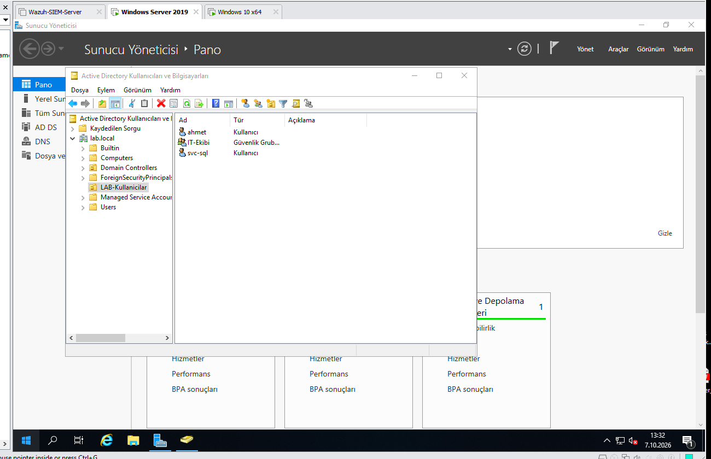

# Aşama 1 — Active Directory

> ✅ Tamamlandı.

## Active Directory nedir?

**Active Directory (AD)**, Microsoft'un kurumsal ağlar için geliştirdiği **dizin
hizmetidir**. Bir şirketteki tüm kullanıcıları, bilgisayarları, grupları ve kaynakları
**tek bir merkezden** yönetmeyi sağlar. Mantığı şudur: her çalışan için her bilgisayara
ayrı hesap açmak yerine, kullanıcı **bir kez** domaine tanımlanır ve yetkisi olan her
makineye aynı hesapla girer (Single Sign-On).

AD'nin kalbinde **kimlik doğrulama** (authentication — "sen gerçekten sen misin?") ve
**yetkilendirme** (authorization — "neye erişebilirsin?") vardır. Bu yüzden AD, bir
saldırganın da **birincil hedefidir**: domaini kontrol eden, şirketin tamamını kontrol eder.

## Anahtar terimler (sözlük)

| Terim | Anlamı |
|-------|--------|
| **Domain** | Ortak bir dizin veritabanını paylaşan nesneler topluluğu (örn. `lab.local`) |
| **Domain Controller (DC)** | AD veritabanını barındıran, kimlik doğrulamayı yapan sunucu |
| **Forest / Tree** | Domainlerin hiyerarşik üst yapısı |
| **OU (Organizational Unit)** | Nesneleri gruplayan "klasör"; GPO uygulama birimi |
| **GPO (Group Policy Object)** | Kullanıcı/bilgisayarlara merkezi politika dağıtan yapı |
| **Kerberos** | AD'nin varsayılan, biletli (TGT/TGS) kimlik doğrulama protokolü |
| **LDAP** | Dizini sorgulama/değiştirme protokolü |
| **SPN** | Bir servisi bir hesaba bağlayan etiket (Kerberos için şart) |
| **DNS bağımlılığı** | AD, DNS'in SRV kayıtları olmadan **çalışmaz** |

## Ne yaptık (adımlar)

1. **Windows Server 2019** kurduk; **AD DS** ve **DNS** rollerini ekleyip sunucuyu
   **Domain Controller'a yükselttik** (promotion), domain adı: `lab.local`.
2. **DC01 (192.168.1.75)** ağ ayarı:
   - DNS **kendini gösterir** → `127.0.0.1`
   - İnternet için DNS rolünde **forwarder**: `192.168.1.1` (veya `8.8.8.8`)
3. **Nesneleri oluşturduk:** OU'lar, kullanıcılar (`ahmet` = sıradan kullanıcı,
   `svc-sql` = servis hesabı), gruplar ve bir GPO.
4. **Windows 10 (LABPC1)** makinesini **domaine kattık** — DNS'i **DC'yi
   (192.168.1.75)** gösterecek şekilde ayarladık.

> **Not:** Makinenin bilgisayar adı `SD2.lab.local`, Wazuh'taki ajan adı ise `DC01`
> olarak kaldı. Loglarda `data.win.system.computer = SD2.lab.local` görürsün; bu
> normal — ikisi farklı kavram (OS hostname vs SIEM ajan adı).

## En kritik ders: DNS

Domaine katılacak her Windows makinesinin DNS'i **mutlaka DC'yi göstermeli.** DNS modemi
(`192.168.1.1`) gösterirse makine domaini bulamaz ve katılamaz. **Yeni başlayanların
1 numaralı takıldığı yer burasıdır.** (Geçici istisna: DC'yi ilk kurarken, DNS rolü
henüz yokken internet için DNS'ini geçici olarak `192.168.1.1` yap; promosyondan sonra
`127.0.0.1`'e çevir.)

## SOC / mavi takım gözüyle

AD, en değerli log kaynağıdır. DC üzerindeki Security kanalı şu olayları üretir:
- **4624 / 4625** — başarılı / başarısız oturum açma
- **4768 / 4769** — Kerberos TGT / TGS istekleri (Kerberoasting'in izi burada)
- **4688** — süreç oluşturma (komut satırıyla birlikte)
- **4720 / 4726 / 4728** — hesap oluşturma / silme / gruba ekleme

Bir SOC analisti için DC loglarını izlemek, saldırganın kimlik hareketlerini görmenin
tek yoludur. Sonraki aşamalarda bu olayları Wazuh'a taşıyıp tespit kuralları yazdık.

---
## Ekran görüntüleri

**`lab.local` domaini — LAB-Kullanıcılar OU'su (sıradan kullanıcı `ahmet`,
servis hesabı `svc-sql`, `IT-Ekibi` grubu):**

