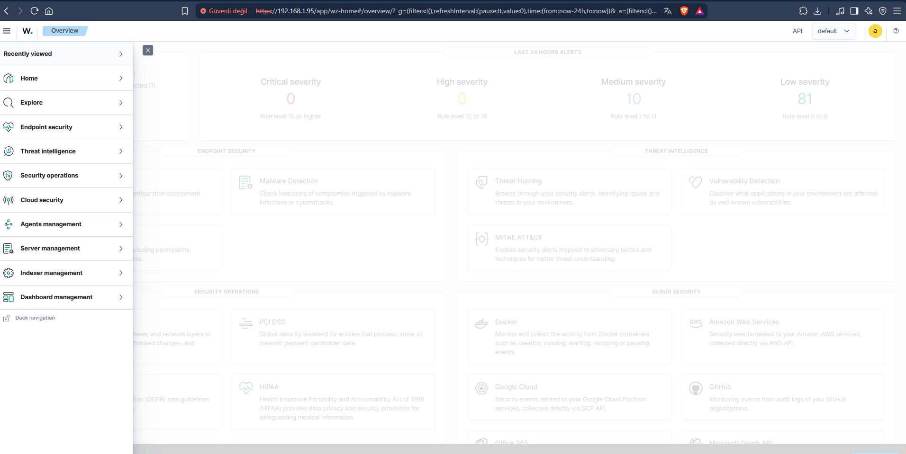
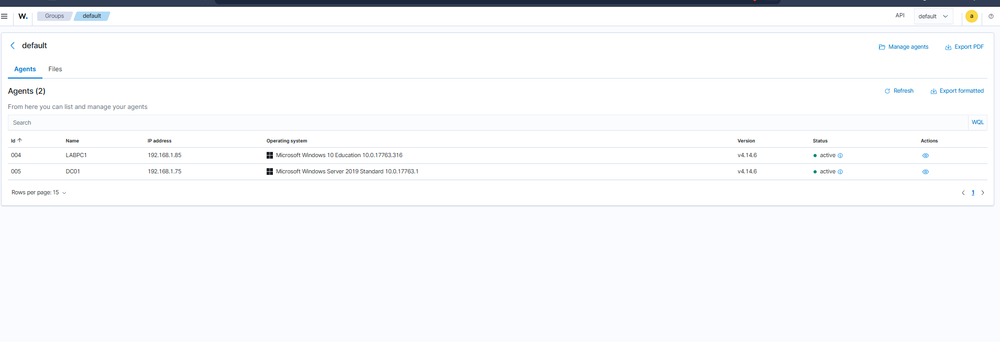

# Aşama 2 — Wazuh SIEM

> ✅ Tamamlandı.

## SIEM nedir? Wazuh nedir? 

**SIEM (Security Information and Event Management)**, bir ağdaki tüm cihazlardan (sunucu, istemci,
firewall...) **logları toplayan**, bunları **normalleştirip ilişkilendiren (correlation)** ve
**tehdit tespit ettiğinde alarm üreten** merkezi sistem. Bir SOC analisti olarak günlük çalışacağım
ana ekranın SIEM olduğunu bildiğim için labın merkezine bunu koydum.

**Wazuh**, açık kaynaklı, ücretsiz bir SIEM + XDR platformu; OSSEC'ten türemiş. Üç ana parçadan
oluşuyor:
- **Wazuh Manager** : logları işleyen, kurallara göre alarm üreten beyin.
- **Wazuh Indexer** (OpenSearch) : logların arandığı/saklandığı veritabanı.
- **Wazuh Dashboard** : görsel arayüz (Threat Hunting, alarmlar, ajan yönetimi).

Uç noktalara (DC, Win10) kurduğum **ajan (agent)**, logları toplayıp Manager'a gönderiyor.

## Anahtar terimler (sözlük)

| Terim | Anlamı |
|-------|--------|
| **Agent** | Uç noktada çalışan, log toplayıp gönderen küçük yazılım |
| **Manager** | Logları kurallarla değerlendirip alarm üreten sunucu |
| **Decoder** | Ham logu alanlara ayıran (parse) bileşen (örn. `windows_eventchannel`) |
| **Rule** | "Şu koşul olursa şu seviyede alarm" tanımı |
| **Rule level** | 0 (sessiz) – 15 (kritik) arası önem derecesi |
| **ossec.conf** | Ajan/manager yapılandırma dosyası |
| **local_rules.xml** | Kendi yazdığım özel kuralların dosyası |
| **DQL** | Dashboard'da arama dili (Discover/Threat Hunting) |

## Ne yaptım (adımlar)

1. **Wazuh 4.14** sunucusunu kurdum: **192.168.1.95**.
2. Dashboard'a girip **Threat Hunting → Events** ekranını tanıdım.
3. **Ajanları kurdum:** DC01 ve LABPC1 üzerine Wazuh agent yükleyip Manager'a kaydettim (enrollment).
4. Sunucuya **SSH anahtarıyla** erişim kurdum (`~/.ssh/wazuh_lab_key`)  kural dosyalarını parola
   girmeden düzenleyebilmek için.

## Karşılaştığım sorunlar ve çözümleri

- **DQL sözdizimi hatası:** `rule.level:>=10` → `DQLSyntaxError`. Doğrusu: `rule.level >= 10`
  (boşluklu, iki nokta yok). Tam eşleşmede iki nokta oluyor: `rule.id:100100`.

## Güvenli çalışma yöntemim (bu labın altın kuralı)

Wazuh kural dosyalarını düzenlerken **Python script** kullandım (sed/bash tırnak sorunları
yaşatıyordu). İş akışım:
1. Script'i host'ta yazıp `scp` ile sunucuya gönderiyorum.
2. `sudo bash /home/melih/<script>.sh` ile çalıştırıyorum .
3. Script kuralı ekliyor + `systemctl restart wazuh-manager` yapıyor.

## SOC / mavi takım gözüyle

- **Rule level mantığı:** 0 = log'la ama alarm verme (gürültü bastırma); 12+ = kritik, e-posta
  bildirimi eşiği. Doğru seviyelendirmenin, analisti alarm selinde boğulmaktan kurtardığını gördüm.
- **Threat Hunting**, olayları DQL ile aramanın yeri  ama dikkat: burada sadece **alarm üretmiş**
  (level ≥ 1) olaylar görünüyor. Level 0 olaylar indekslenmiyor.

---
## Ekran görüntüleri

**Wazuh Overview  son 24 saat alarm dağılımı (severity seviyeleri):**

**Kayıtlı ajanlar aktif  DC01 (`192.168.1.75`) ve LABPC1 (`192.168.1.85`):**

