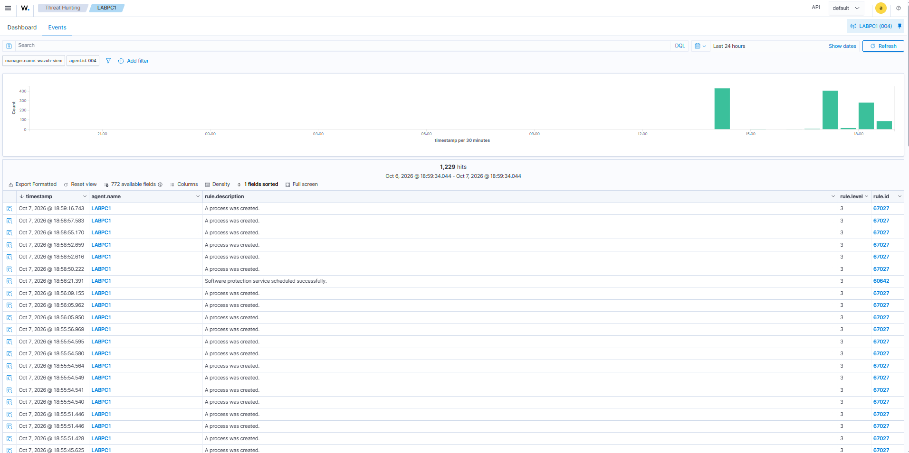

# Aşama 3 — Loglama ve Sysmon

> ✅ Tamamlandı.

## Neden loglama? Sysmon nedir?

Bir saldırıyı **tespit edebilmem için, saldırının iz bırakması** gerekir. Windows'un varsayılan
logları çoğu zaman yetersiz  örneğin hangi sürecin hangi komutla, kim tarafından başlatıldığını
detaylı göstermiyor. Bu aşamada amacım **görünürlüğü (visibility) artırmak**tı: daha fazla ve daha
zengin log üretmek.

**Sysmon (System Monitor)**, Microsoft Sysinternals'ın ücretsiz aracı. Bir Windows servisi olarak
çalışıyor ve normalde görünmeyen **düşük seviyeli sistem olaylarını** (süreç oluşturma + hash +
komut satırı, ağ bağlantıları, uzak thread enjeksiyonu, dosya oluşturma...) kendi olay kanalına
yazıyor: `Microsoft-Windows-Sysmon/Operational`.

**SwiftOnSecurity config:** Sysmon'u sıfırdan yapılandırmak zor; topluluğun hazırladığı bu
yapılandırma dosyasını, gürültüyü eleyip anlamlı olayları toplayan sağlam bir başlangıç olarak
kullandım.

## Anahtar Event ID'ler (ezberlenmeli)

### Sysmon olayları (`Microsoft-Windows-Sysmon/Operational`)
| ID | Olay | Neden önemli |
|----|------|--------------|
| **1** | Süreç oluşturma | Komut satırı + **hash** + ebeveyn süreç → en değerli olay |
| **3** | Ağ bağlantısı | Hangi süreç nereye bağlandı (C2 tespiti) |
| **8** | CreateRemoteThread | Kod enjeksiyonu (Mimikatz, process injection) |
| **11** | Dosya oluşturma | Dropper, zararlı dosya yazımı |

### Windows Security olayları (denetim açılınca)
| ID | Olay |
|----|------|
| **4688** | Süreç oluşturma (komut satırıyla)  Windows'un yerlisi |
| **4624 / 4625** | Başarılı / başarısız oturum açma |
| **4769** | Kerberos servis bileti isteği (Kerberoasting) |

## Ne yaptım (adımlar)

1. **Sysmon kurulumu**  DC01 ve LABPC1'e SwiftOnSecurity config ile Sysmon yükledim:
   ```powershell
   Sysmon64.exe -accepteula -i sysmonconfig-export.xml
   # config güncelleme:
   Sysmon64.exe -c sysmonconfig-export.xml
   ```
2. **Wazuh'a Sysmon kanalını tanıttım**  her iki makinede `ossec.conf`'a ekledim:
   ```xml
   <localfile>
     <location>Microsoft-Windows-Sysmon/Operational</location>
     <log_format>eventchannel</log_format>
   </localfile>
   ```
3. **Gelişmiş denetim politikasını açtım (GPO ile)**  süreç oluşturma komut satırı, oturum açma,
   Kerberos bilet işlemleri vb. (Türkçe sunucuda: *Bilgisayar Yapılandırması → İlkeler → Windows
   Ayarları → Güvenlik Ayarları → Gelişmiş Denetim İlkesi Yapılandırması*).
4. **Doğruladım:**
   ```cmd
   auditpol /get /category:*
   ```
   Önce hepsi "No Auditing" idi; ayarlardan sonra "Success and Failure" oldu.

## Karşılaştığım sorunlar ve çözümleri

- **Sysmon satırı sessizce eklenmedi:** PowerShell `-replace '</ossec_config>\s*$'` regex'i
  "eklendi" dedi ama aslında eklememişti. Çözümüm: `$raw.LastIndexOf('</ossec_config>')` +
  `Insert()` ile kesin konuma yerleştirdim, satır 219'da doğruladım.
  → **Çıkardığım ders: "güven ama doğrula"**  bir komut "başarılı" dese bile sonucu teyit ediyorum.
- **Türkçe sunucu menüleri:** GPO yollarını Türkçe menüde (Gelişmiş Denetim İlkesi Yapılandırması vb.)
  bularak ilerledim.

## SOC / mavi takım gözüyle

- **Sysmon Event 1 vs Windows 4688:** İkisi de süreç oluşturmayı gösteriyor, ama Sysmon 1 **hash** ve
  daha zengin alan veriyor (dosya imzası, ebeveyn komut satırı). İkisini birden toplamanın en iyisi
  olduğuna karar verdim.
- **Görünürlük = tespit tavanı:** Toplamadığım log, yazamayacağım kural demek. Bir tespit mühendisi
  olarak önce "bu saldırı hangi olayı üretir, o olayı topluyor muyum?" diye soruyorum.

---
## Ekran görüntüleri

**Sysmon çalışıyor  Wazuh'a akan süreç oluşturma (process create) olayları:**


