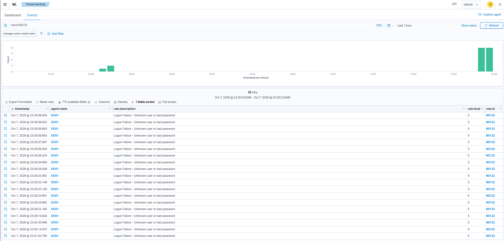
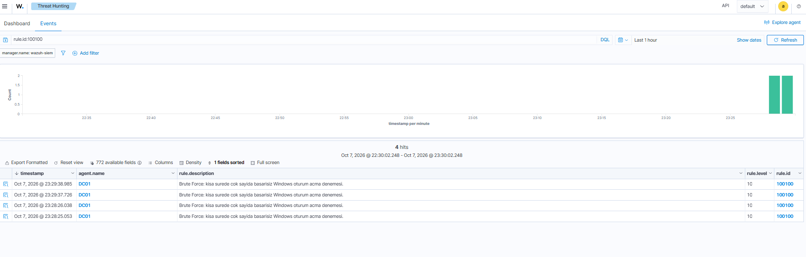

# Aşama 5 — Brute-force Tespiti

> ✅ Tamamlandı.

## Brute-force nedir?

**Brute-force (kaba kuvvet)** saldırısı, bir hesabın parolasını **deneme-yanılmayla** bulmaya
çalışmak: saldırgan aynı kullanıcı için yüzlerce/binlerce parola dener. Türleri:
- **Klasik brute-force:** Tek hesaba çok parola.
- **Password spraying:** Çok hesaba az (yaygın) parola  hesap kilitlemeyi atlatmak için.
- **Credential stuffing:** Başka sızıntılardan çalınan kullanıcı/parola çiftlerini denemek.

Windows'ta her başarısız giriş **Event ID 4625**, her başarılı giriş **4624** üretiyor. Tespitin
özü: **kısa sürede çok sayıda 4625** görmek  ve ardından **aynı kaynaktan bir 4624** gelirse,
"saldırı başarılı olmuş olabilir" demek.

## Anahtar terimler ve Event ID'ler

| Öğe | Anlamı |
|-----|--------|
| **4625** | Başarısız oturum açma |
| **4624** | Başarılı oturum açma |
| **Logon Type** | 2=konsol, 3=ağ, 10=RDP  saldırı vektörünü gösterir |
| **Eşik (threshold)** | "X dakikada N deneme" → alarm sınırı |
| **frequency / timeframe** | Wazuh'ta "N olay / T saniye" korelasyon parametreleri |
| **if_matched_sid** | "Şu kural N kez tetiklenirse"  korelasyonun temeli |

## Wazuh kuralı nasıl yazılır? (bu repodaki ilk kuralım burada)

> Bu bölüm, bu depodaki **tüm** özel kurallarımın (100100, 100300, 100500...) temeli. İlk kuralı
> yazdığım yer burası olduğu için genel rehberi buraya koydum; sonraki aşamalarım (06, 07, 10,
> 14...) bu mantığı tekrar tekrar uyguluyor.

### 1) Kural nerede yaşar?
Wazuh manager'da iki ayrı dünya var:

| Konum | İçerik | Kural? |
|-------|--------|--------|
| `/var/ossec/ruleset/rules/` | Wazuh'un **hazır** kuralları (60122, 92650...) | ❌ Dokunma  güncellemede ezilir |
| `/var/ossec/etc/rules/local_rules.xml` | **Kendi özel** kurallarım (100100...) | ✅ Her şeyi buraya yazarım |

### 2) Bir kuralın iskeleti
Her kural üç soruyu yanıtlar: **(a)** hangi olaya bakıyorum, **(b)** içinde neyi arıyorum,
**(c)** bulursam ne kadar ciddi.

```xml
<group name="windows,authentication_failures,">
  <rule id="100100" level="10" frequency="5" timeframe="120">
    <if_matched_sid>60122</if_matched_sid>            <!-- (a) hangi olay -->
    <description>Brute Force: kisa surede cok sayida ...</description>  <!-- analiste mesaj -->
    <mitre><id>T1110</id></mitre>                     <!-- ATT&CK etiketi -->
  </rule>
</group>
```

- **`id`** → **100000 ve üstü kullanıcıya aittir.** Altı Wazuh'undur; çakışırsan test reddeder.
- **`level`** → **0 = sessiz (bastırma/FP), 15 = kritik.** Aşama 11'deki triyaj önceliğini
  doğrudan buradan okuyorum.
- **`<group>`** → etiketleme; başka kurallar `if_group` ile buna bağlanabilir.

### 3) "İçinde neyi arıyorum"  eşleştirme yapı taşları
Kuralın kalbi bu öğeler:

| Öğe | Ne yapar |
|-----|----------|
| `<if_sid>60122</if_sid>` | Kuralı 60122'nin **çocuğu** yapar; önce o eşleşmezse bu hiç çalışmaz (hız + isabet) |
| `<if_group>sysmon</if_group>` | Bir **gruptaki** herhangi kuralın çocuğu (tek id'ye bağlı kalmazsın) |
| `<if_matched_sid>` + `frequency`/`timeframe` | **Korelasyon:** "60122, 120 sn'de 5 kez tetiklenirse" → tek olayı değil *deseni* yakalar |
| `<field name="win.system.eventID">^13$</field>` | Çözümlenmiş (decoded) bir **alanı** eşler; `^...$` = tam eşleşme |
| `type="pcre2"` | O alanda PCRE2 regex çalıştırır (`(?i)` = büyük/küçük harf duymaz) |
| `<match>` / `<regex>` | Ham log metninde düz arama / OS_Regex |

> **İki katmanlı tasarımın (Aşama 14) sırrı burada:** *taban* kural `if_group`/`field` ile
> "olayı gör", *çocuk* kural `if_sid` + ikinci bir `field` ile "şüpheliyse yükselt".

### 4) En kritik becerim: alan adını nereden bulurum?
`win.eventdata.targetObject` gibi isimleri **ezberlemiyorum**  olayın ham JSON'ından okuyorum:

1. Saldırıyı bir kez yapıyorum, Wazuh dashboard'da alarmı açıyorum.
2. **`data` / `_source`** bloğuna bakıyorum: `win.eventdata.image`, `win.eventdata.commandLine`...
   Kurala bu yolu aynen yazıyorum.
3. Ya da manager'da **`/var/ossec/bin/wazuh-logtest`** aracına örnek logu yapıştırıyorum; hangi
   decoder hangi alanları çıkardı ve hangi kural tetiklendi  satır satır gösteriyor. Kural
   geliştirmenin en hızlı yolu bu (her denemede restart gerekmiyor).

### 5) Geliştirme döngüm
```
yaz → wazuh-analysisd -t (sözdizimi + çakışma testi) → wazuh-logtest (örnek logla dene)
    → systemctl restart wazuh-manager → saldırıyı tetikle → dashboard'da doğrula
```
Her değişiklikte **önce yedek**, sonra `-t` testi; hata/CRITICAL varsa geri alıyorum.

### 6) Sık düştüğüm tuzaklar
- **`id` 100000 altında** → Wazuh'unkiyle çakışır, reddedilir.
- **eventchannel çift ters bölü** → yol/registry alanlarında `\` → `\\` olur; regexte `\\+`
  kullanıyorum (bkz. Aşama 14  birebir bu tuzağa düştüm).
- **`if_sid`/`if_group` koymamak** → kural her loga karşı çalışır: yavaş + beklenmedik eşleşmeler.
  Mümkünse bir ebeveyne/gruba bağlıyorum.

## Ne yaptım (adımlar)

1. Başarısız giriş olaylarını (**4625**) Wazuh'ta izledim. Wazuh'un hazır **rule 60122** kuralı tek
   tek başarısızlıkları yakalıyordu ama bir "saldırı" resmi çizmiyordu.
2. **Özel korelasyon kuralımı (100100)** yazdım: 120 saniyede 5 başarısız deneme → **level 10**.
   ```xml
   <group name="windows,authentication_failures,">
     <rule id="100100" level="10" frequency="5" timeframe="120">
       <if_matched_sid>60122</if_matched_sid>
       <description>Brute Force: kisa surede cok sayida basarisiz Windows oturum acma denemesi.</description>
       <mitre><id>T1110</id></mitre>
     </rule>
   </group>
   ```
3. Saldırıyı LABPC1'den tetikledim; **level 10 alarm** düştü.

### Kuralı parça parça (100100)
| Satır | Ne yapar |
|-------|----------|
| `<group name="windows,authentication_failures,">` | Kuralı bu etiketlerle gruplar; dashboard'da `rule.groups` ile filtrelenir |
| `id="100100"` | Özel kural kimliği (100000+ bana ait) |
| `level="10"` | Yüksek-orta ciddiyet → triyajda öncelikli |
| `frequency="5" timeframe="120"` | **Eşik:** 120 saniye içinde 5 kez |
| `<if_matched_sid>60122</if_matched_sid>` | **Korelasyonun kalbi:** "60122 (tek başarısız giriş) kuralı eşik kadar tekrarlarsa" tetikle. Tek olayı değil, *deseni* yakalar |
| `<description>` | Alarm düşünce gördüğüm mesaj |
| `<mitre><id>T1110</id></mitre>` | ATT&CK eşlemesi (Brute Force) |

> **Neden `if_matched_sid`, `if_sid` değil?** `if_sid` tek bir olayda tetiklenir; burada amacım
> "5 başarısızlık" desenini saymak, bu yüzden `frequency`/`timeframe` ile çalışan `if_matched_sid`
> gerekiyor.

## Karşılaştığım sorunlar ve çözümleri

- **Korelasyon ilk başta tetiklenmedi:** Varsayılan `authentication_failures` (40111) Windows ağ
  oturumlarında srcip'i ilişkilendirmiyordu. Çözümüm: `if_matched_sid 60122` tabanlı özel kural +
  manager restart sonrası **120 sn içinde 10+ hızlı deneme**.
- **Saldırıyı LABPC1'den yaptım ama alarm DC01'de çıktı  neden?** Çünkü ağ oturum açma (logon type
  3) kimlik doğrulaması **DC üzerinde** gerçekleşiyor; 4625 olayı domain hesabı için DC'de üretiliyor.

## Bonus: Yanlış pozitif (FP) ayıklama  "güven ama doğrula"

Bir sabah cihazlar açılır açılmaz **level 12 alarm** düştü: Sysmon olayında (rule 61640)
`explorer.exe` şüpheli görünüyordu. Panik yapmadan **kanıta** gittim:
```powershell
Get-AuthenticodeSignature C:\Windows\explorer.exe   # imza geçerli mi?
Get-FileHash C:\Windows\explorer.exe                # hash bilinen iyi mi?
```
İmza **Valid**, hash eşleşti → bu **meşru** bir explorer.exe'ydi, yani **yanlış pozitif**. Ebeveyni
güvenilir sistem süreçleriydi (`winlogon`/`svchost`/`userinit`). Bastırma kuralını (level 0) yazdım:
```xml
<rule id="100200" level="0">
  <if_sid>61640</if_sid>
  <field name="win.eventdata.parentImage" type="pcre2">(?i)(winlogon|svchost|userinit)\.exe$</field>
  <description>Benign: explorer.exe guvenilir sistem ebeveyninden - FP bastirildi</description>
</rule>
```

**Kuralı parça parça (100200  bastırma/suppression):**
| Satır | Ne yapar |
|-------|----------|
| `level="0"` | **Sessiz:** eşleşir ama alarm üretmez → gürültüyü susturur (100100'deki level 10'un tersi) |
| `<if_sid>61640</if_sid>` | Yalnızca 61640'ın tetiklendiği olaylara uygulan (o kuralın çocuğu) |
| `<field name="win.eventdata.parentImage" type="pcre2">(?i)(winlogon\|svchost\|userinit)\.exe$</field>` | Ebeveyn süreç bu **bilinen iyi** sistem süreçlerinden biriyse; `(?i)` harf duymaz, `\.exe$` ".exe" ile biter, `(a\|b\|c)` = alternatifler |

> Burada `level="0"` + dar bir `field` deseni = **hedefli bastırma**: kanalı tümden kapatmadan
> sadece bilinen iyi deseni susturuyorum.

→ **Çıkardığım ders:** Her alarmı önce **kanıtla** doğruluyorum (imza, hash, ebeveyn süreç).
Meşruysa, gelecekte gürültü yapmaması için **hedefli** bir bastırma kuralı yazıyorum (kanalı
tamamen kapatmıyorum  sadece bilinen iyi deseni susturuyorum).

## SOC / mavi takım gözüyle

- **Eşik seçimi** bir denge sanatı: çok düşük → FP seli; çok yüksek → saldırıyı kaçırma.
- **4625 ardından 4624 (aynı IP):** en kritik senaryo  saldırı başarıya ulaşmış olabilir, önce
  bunu incelerim.
- **Logon Type**'ı her zaman kontrol ediyorum: Type 3 (ağ) ve Type 10 (RDP) saldırılarda yaygın.

---
## Kanıt  alarm detayı (Wazuh)

```text
# Wazuh alarmı — rule.id 100100 (level 10)
rule.description : Brute Force: kisa surede cok sayida basarisiz Windows oturum acma denemesi
rule.mitre       : T1110 — Brute Force (Credential Access)
agent.name       : DC01 (192.168.1.75)   # domain hesabı doğrulaması DC'de olur
korele olay      : 60122 / Event 4625 (başarısız oturum açma) — eşik: 120 sn'de 5+
kaynak           : 192.168.1.85 (LABPC1, LAB\ahmet denemeleri)
```

## Ekran görüntüleri

**Ham kanıt  kısa sürede çok sayıda 4625 başarısız oturum açma (kural 60122):**



**Tespit  özel kural 100100 tetiklendi (brute-force, level 10):**


