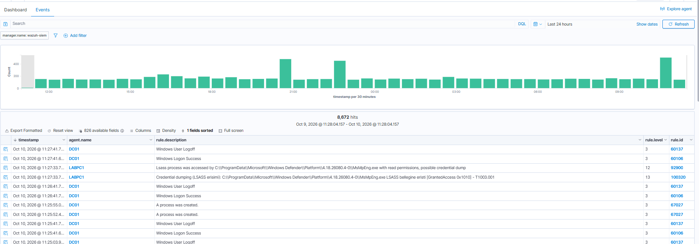
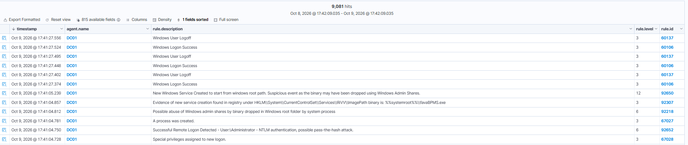
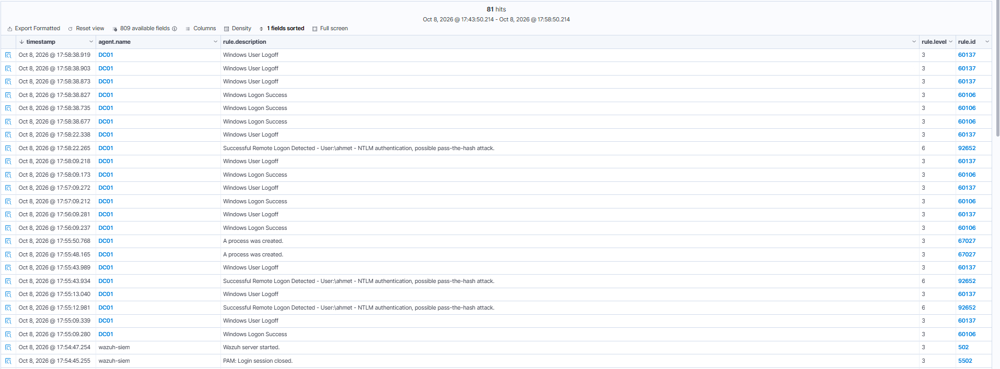

# Aşama 7 — Post-exploitation

> ✅ Tamamlandı (credential dumping + lateral movement).

## Post-exploitation nedir?

**Post-exploitation (sömürü sonrası)**, saldırganın bir makineye **eriştikten sonra** yaptıkları:
kimlik bilgisi çalmak (credential access) ve ağda yayılmak (lateral movement). Bir saldırının en
tehlikeli kısmının genelde ilk erişim değil, **sonrası** olduğunu biliyorum  çünkü saldırgan artık
içeride ve meşru kullanıcı gibi davranıyor.

Bu aşamada iki teknik çalıştım ve **iki farklı tespit felsefesi** öğrendim:
1. **Credential dumping** (sessiz teknik → **özel kural** yazmam gerekti)
2. **Lateral movement / PsExec** (gürültülü teknik → **hazır ruleset** yakaladı)

---

# BÖLÜM 1  Credential dumping (Mimikatz / LSASS) T1003.001

## 1.1 Amaç ve ortam

**LSASS** (Local Security Authority Subsystem Service), Windows'ta oturum açmış kullanıcıların
kimlik bilgilerini (NTLM hash, Kerberos bileti, bazen açık parola) **bellekte** tutan süreç.
**Mimikatz**, admin yetkisiyle LSASS belleğini okuyup bu kimlikleri çıkaran ünlü araç.

| Bileşen | Değer |
|---------|-------|
| Hedef makine | LABPC1 (192.168.1.85) |
| Araç | Mimikatz 2.2.0 → `C:\Tools\mimikatz\x64\mimikatz.exe` |
| Çalıştıran | LABPC1\melih (yükseltilmiş yetki) |

## 1.2 Saldırı  komutlar

```powershell
# Hazırlık (lab, snapshot var): Defender Tamper + Real-time kapatildi, arac indirildi
C:\Tools\mimikatz\x64\mimikatz.exe "privilege::debug" "sekurlsa::logonpasswords" "exit"
```
- `privilege::debug` → **SeDebugPrivilege** etkin → `Privilege '20' OK` (LSASS'ı açma yetkisi).
- `sekurlsa::logonpasswords` → LSASS belleğini okuyup kimlikleri döker.

**Sonuç:** `ERROR kuhl_m_sekurlsa_acquireLSA ; Key import`  Mimikatz sürümüm bu Windows
derlemesinden eski olduğu için anahtarları çözemedi, **dump başarısız oldu**.

> **Kritik SOC prensibi:** Dump başarısız olsa bile Mimikatz **LSASS'a erişti** (handle açtı,
> belleği okudu, sadece son adımda patladı). **Başarısız saldırı da tespit edilmeli**  birinin
> LSASS'a erişmeye çalışması başlı başına kritik bir olay.

## 1.3 Loglar ve tespit  iki katman

### Katman 1: Araç-merkezli (Sysmon Event 1  process creation)
Mimikatz çalışınca Sysmon **Event 1** üretti. Zengin alanlar: `commandLine`
(`sekurlsa::logonpasswords`), `originalFileName` (mimikatz.exe), `product` (mimikatz),
`company` (gentilkiwi), `hashes` (IMPHASH=55EE500BB4BDFC49F27A98AE456D8EDF).

**Kural 100310** (en sağlam sinyal bence = komut satırı imzası):
```xml
<group name="sysmon,attack,credential_access,">
  <rule id="100310" level="12">
    <if_group>sysmon</if_group>
    <field name="win.system.eventID">^1$</field>
    <field name="win.eventdata.commandLine" type="pcre2">(?i)(sekurlsa|privilege::debug|lsadump|logonpasswords|kerberos::golden|mimikatz)</field>
    <description>Kimlik hirsizligi (Mimikatz) suphesi: komut satirinda Mimikatz imzasi (T1003.001)</description>
    <mitre><id>T1003.001</id></mitre>
  </rule>
</group>
```

**Kuralı parça parça (100310):**
| Satır | Ne yapar |
|-------|----------|
| `<if_group>sysmon</if_group>` | Her Sysmon olayının altında değerlendir |
| `<field name="win.system.eventID">^1$</field>` | Sadece **Event 1** (süreç oluşturma) |
| `<field name="win.eventdata.commandLine" type="pcre2">(?i)(sekurlsa\|privilege::debug\|...)</field>` | Komut satırında **Mimikatz imzalarından biri** geçiyorsa; `(?i)` harf duymaz, `(a\|b\|c)` = alternatiflerden herhangi biri |
| `level="12"` | Kritik-yüksek |

**Zayıflığı:** Araç yeniden adlandırılır/komut değişirse kaçar (araç-merkezli).

### Katman 2: Davranışsal (Sysmon Event 10 ProcessAccess)
**Önce görünürlük açmam gerekti:** SwiftOnSecurity config ProcessAccess'i (Event 10) varsayılan
**kapalı** bırakıyor. Sysmon config'ine lsass.exe'ye erişimi izleyen kuralı ekleyip uyguladım.
Sonra Mimikatz'ı tekrar çalıştırdığımda Event 10 oluştu:
```
SourceImage: mimikatz.exe → TargetImage: lsass.exe | GrantedAccess: 0x1010
```
`0x1010` = `PROCESS_VM_READ (0x10)` + `PROCESS_QUERY_INFORMATION (0x1000)` = "belleğini oku". Bu,
kimlik hırsızlığının klasik erişim maskesi.

**Kural 100320** (davranışsal araçtan bağımsız):
```xml
<group name="sysmon,lsass,attack,">
  <rule id="100320" level="13">
    <if_group>sysmon</if_group>
    <field name="win.system.eventID">^10$</field>
    <field name="win.eventdata.targetImage" type="pcre2">(?i)\\lsass\.exe$</field>
    <field name="win.eventdata.grantedAccess" type="pcre2">(?i)^0x(1010|1410|1438|143a|1fffff)$</field>
    <description>Credential dumping (LSASS erisimi): $(win.eventdata.sourceImage) LSASS bellegine eristi [GrantedAccess $(win.eventdata.grantedAccess)] - T1003.001</description>
    <mitre><id>T1003.001</id></mitre>
  </rule>
</group>
```

**Kuralı parça parça (100320):**
| Satır | Ne yapar |
|-------|----------|
| `<field name="win.system.eventID">^10$</field>` | Sadece **Event 10** (ProcessAccess — bir sürecin başka sürece erişimi) |
| `<field name="win.eventdata.targetImage" type="pcre2">(?i)\\lsass\.exe$</field>` | Erişilen hedef, yolu `\lsass.exe` ile biten süreç; `\.` = gerçek nokta, `$` = sonu |
| `<field name="win.eventdata.grantedAccess" type="pcre2">(?i)^0x(1010\|1410\|...)$</field>` | Verilen erişim maskesi, **"belleği oku"** anlamına gelen bilinen değerlerden biri (0x1010 = VM_READ + QUERY_INFORMATION) |
| `level="13"` | 100310'dan (12) **daha yüksek** — çünkü bu sinyal davranışsal, atlatması çok daha zor |

> **Üç `field` üst üste (VE):** Event 10 **ve** hedef lsass.exe **ve** okuma-erişim maskesi. Üçü
> birlikte "biri LSASS belleğini okuyor" demek — araç adına hiç bakmadan.

**Üstünlüğü:** Araç adı ne olursa olsun (mimikatz, comsvcs, procdump, özel kod), LSASS'a
okuma-erişim yapan her şeyi yakalıyor. **Tekniği yakalıyor, aracı değil.** Ayrıca olaydaki
`CallTrace` alanı, erişimin hangi modülden geldiğini gösteren adli bir kanıt.

### Kanıt ürettiğim alarmlar (Wazuh)

```text
# rule.id 100310 (level 12)  araç-merkezli (imza)
rule.description : Kimlik hirsizligi (Mimikatz) suphesi: komut satirinda Mimikatz imzasi (T1003.001)
image            : C:\Tools\mimikatz\x64\mimikatz.exe
commandLine      : "...\mimikatz.exe" privilege::debug sekurlsa::logonpasswords exit
mitre            : T1003.001  LSASS Memory (Credential Access)

# rule.id 100320 (level 13)  davranışsal (asıl değerli)
rule.description : Credential dumping (LSASS erisimi): mimikatz.exe LSASS bellegine eristi [GrantedAccess 0x1010]
sourceImage      : C:\Tools\mimikatz\x64\mimikatz.exe
targetImage      : C:\Windows\system32\lsass.exe
grantedAccess    : 0x1010 (PROCESS_VM_READ | QUERY_INFORMATION = "belleğini oku")
mitre            : T1003.001  LSASS Memory
```

### Katman 3: Yanlış pozitif tuning  100321 (LSASS allowlist)

Davranışsal kural (100320) güçlü ama **geniş ağ atıyor**: LSASS'a okuma-erişim yapan *meşru* sistem
süreçleri de tetikliyor. Lab'da gözlemlediğim gerçek false positive kaynakları:

| Kaynak süreç | Neden LSASS'a erişir |
|--------------|----------------------|
| `MsMpEng.exe` (Windows Defender) | Antivirüs taraması süreç belleklerini okur |
| `wazuh-agent.exe` | SIEM ajanı güvenlik izlemesi yapar |
| `wininit.exe`, `csrss.exe` | Açılış/oturum başlatmada meşru sistem erişimi |

Bunlar **BTP** (gerçekten oldu ama yetkili). Çözümüm: kuralı bozmadan, bu **bilinen-güvenilir
kaynakları tam yollarıyla** susturan bir **bastırma kuralı** (level 0):

```xml
<rule id="100321" level="0">
  <if_sid>100320</if_sid>
  <field name="win.eventdata.sourceImage" type="pcre2">(?i)(\\+Windows Defender\\+Platform\\+.*MsMpEng\.exe|\\+ossec-agent\\+wazuh-agent\.exe|\\+System32\\+wininit\.exe|\\+System32\\+csrss\.exe)$</field>
  <description>Benign: LSASS erisimi bilinen guvenilir sistem sureci - FP bastirildi (BTP istisna)</description>
</rule>
```

**Neden tam yol?** Sadece dosya adıyla (`MsMpEng.exe`) bastırsaydım, saldırgan aracını o adla başka
bir klasöre koyup kaçardı. Tam yol-ankrajı (`...\Windows Defender\Platform\...`) bunu önlüyor.

**Doğrulama (regex, gerçek yollara karşı test ettim):**
```text
Defender / wazuh-agent / wininit / csrss  -> True  (bastırıldı, level 0 → sessiz)
mimikatz / procdump / bilinmeyen           -> False (hâlâ level 13 alarm üretir)
```

> **İteratif tuning dersi:** Önce yalnızca Defender'ı bastırdım; test edince `wazuh-agent`,
> `wininit`, `csrss` gibi başka meşru kaynaklar ortaya çıktı → allowlist'i genişlettim. Gerçek SOC
> tuning'inin hep böyle olduğunu gördüm: **bastır → gözlemle → genişlet** (Aşama 5'teki
> explorer→winlogon genişlemesinin aynısı).

> **Dengenin bedeli (dürüst not):** Her tuning bir **kör nokta** riski taşıyor  teorik olarak
> saldırgan bu korumalı dizinlere (System32, Defender Platform, ossec-agent) yazabilirse kaçar. Ama
> oralara yazmak zaten yüksek yetki + ayrı bir alarm gerektiriyor; "kabul edilebilir risk"
> karşılığında gürültü ciddi azalıyor.

---

# BÖLÜM 2  Lateral movement (PsExec)  T1021.002

## 2.1 Saldırı komut
Kali'den, ele geçirdiğim admin kimliğiyle DC'ye uzaktan kod çalıştırma:
```bash
impacket-psexec 'lab.local/Administrator:<parola>@192.168.1.75'
```
PsExec'in iç işleyişi (çıktıdan): `ADMIN$` paylaşımına bağlan → rastgele adlı bir exe yükle →
hedefte bir servis oluştur → servisi başlat → SYSTEM shell aç.

> Lab'da shell tam açılmadı (DC'de Defender servis binary'sini engelledi), ama lateral movement'in
> **tüm izleri** zaten oluştu  tespit için bu bana yetti.

## 2.2 Tespit  hazır ruleset yakaladı (kural yazmadım!)
PsExec çok bilinen ve gürültülü olduğu için Wazuh'un **varsayılan kuralları** saldırıyı adım adım
yakaladı:

| Rule | Seviye | Yakaladığı |
|------|--------|-----------|
| 67028 | 3 | 4672  yeni oturuma özel yetkiler (admin girişi) |
| **92652** | 6 | Uzaktan NTLM oturum açma (Administrator)  olası pass-the-hash (4624 Type 3) |
| **92218** | 6 | Admin paylaşımı kötüye kullanımı  Windows klasörüne binary bırakma |
| 92307 | 3 | Registry'de yeni servis kaydı |
| **92650** | **12** | Windows kök dizininden başlayan, admin paylaşımıyla bırakılmış servis (PsExec imzası) |

Kill-chain görünür: **uzaktan giriş → admin paylaşımına dosya → servis oluşturma → çalıştırma.**

---

## 3. En büyük ders: hazır kural mı, özel kural mı?

| Teknik | Gürültü | Varsayılan ruleset | Benim aksiyonum |
|--------|---------|--------------------|-----------------|
| Credential dumping (LSASS) | Sessiz | Yakalamadı | Görünürlük açtım + 2 özel kural |
| Lateral movement (PsExec) | Gürültülü | Yakaladı (lvl 12) | Hiçbir şey  sadece doğruladım |

**Benimsediğim olgun SOC yaklaşımı:** Her şeye kör körüne özel kural yazmamak. Önce hazır
ruleset'in neyi kapsadığını görürüm, sadece **boşlukları** (sessiz teknikleri) özel kuralla
doldururum.

---

## 4. MITRE ATT&CK

| Teknik | Taktik |
|--------|--------|
| T1003.001  LSASS Memory | Credential Access |
| T1021.002  SMB/Windows Admin Shares | Lateral Movement |
| T1570  Lateral Tool Transfer | Lateral Movement |
| T1569.002 Service Execution | Execution |
| T1550.002 Pass-the-Hash (ilişkili) | Lateral Movement |
| T1562.001 Impair Defenses (Defender kapatma) | Defense Evasion |

---

## 5. Önlem

### Credential dumping'e karşı
- **Credential Guard** + **LSA Protection (RunAsPPL)** → LSASS'ı korumalı sürece çevirir, Mimikatz'ı engeller.
- **EDR** → LSASS erişimini davranışsal engeller.
- **Domain Admin'ler iş istasyonlarına girmesin** → düşük güvenli makinede DA hash'i bellekte durmasın.
- **WDigest kapalı** (açık parola bellekte tutulmasın).

### Lateral movement'a karşı
- **LAPS** → her makinede benzersiz local admin parolası (bir hash her yeri açmaz).
- **SMB imzalama**, admin paylaşımlarını kısıtlama, ağ segmentasyonu.
- **En az yetki** + **NTLM'i mümkün olduğunca kapatma** (Kerberos'a zorlama).

### Bonus tespit
- **Defender'ın kapatılması** (T1562.001) başlı başına bir alarm  gerçek ortamda bunu da izlerim.

---

## 6. Karşılaştığım sorunlar ve çözümleri

- **Mimikatz "Key import" hatası:** Araç sürümü Windows derlemesinden eski. Çözüm için gerekmedi
  (dump başarısız olsa da LSASS erişimini tespit ettim); gerçek hash için **pypykatz** ile offline
  minidump çözümü alternatif.
- **Event 10 hiç oluşmuyordu:** SwiftOnSecurity config ProcessAccess'i kapalı bırakıyor → Sysmon
  config'ine lsass ProcessAccess ekledim.
- **Ekledim ama yine çalışmadı (dual-block):** Config'deki **ilk** (boş) ProcessAccess bloğu
  benimkini eziyordu. Sysmon bir olay tipi için ilk bloğu kullanıyor. Çözümüm: lsass'ı **ilk** bloğa
  koyup fazlalığı silmek.
- **psexec `STATUS_LOGON_FAILURE`:** Komutta `<...>` yer tutucu parantezlerini yazmıştım →
  parolanın parçası oldu. Çözümüm: parantezleri silip özel karakterli parolayı tek tırnakla korumak.

---

## 7. Ekran görüntüleri

**Credential dumping tespiti özel kural 100320 (LSASS belleğine erişim,
GrantedAccess 0x1010, T1003.001, level 13):**



**Lateral movement  PsExec kill-chain'i (yeni servis 92650, admin paylaşımı 92218,
registry servis kaydı 92307):**



**Pass-the-hash  çalınan kimlikle uzaktan NTLM oturumu (kural 92652):**




