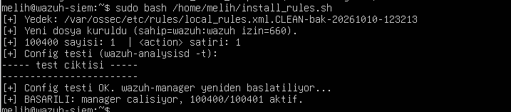
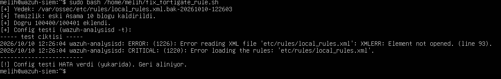

# Aşama 10 — FortiGate Entegrasyonu

> ✅ Tamamlandı  FortiGate'i (PNETLab, `192.168.1.23`) syslog ile Wazuh'a bağladım, logları
> `fortigate-firewall-v5` decoder'ı ile ayrıştırdım ve network-katmanı bir **port tarama / ağ keşfi
> tespiti (T1046, kural 100401)** yazıp gerçek bir Kali nmap taramasıyla doğruladım.

## Firewall / FortiGate nedir? Neden SIEM'e log gönderirim?

**Güvenlik duvarı (firewall)**, ağ trafiğini kurallara göre denetleyen cihaz  hangi bağlantıya izin
verilir, hangisi engellenir. **FortiGate**, Fortinet'in kurumlarda çok yaygın kullanılan firewall/UTM
ürünü (IPS, web filtreleme, VPN, uygulama kontrolü de içeriyor).

Bir firewall kendi başına **güvenlik olaylarını görüyor** (engellenen bağlantılar, port taramaları,
IPS tetiklenmeleri) ama bu loglar cihazda kalırsa kimse bakmaz. Bu yüzden firewall loglarını
**syslog** ile SIEM'e gönderdim: böylece uç nokta loglarıyla **ağ loglarını aynı yerde**
ilişkilendirip bütün resmi görebiliyorum.

## Bridge modu notu (bu labın özel durumu)

Bu lab **bridge** ağ kullandığı için FortiGate, trafiğin önünde duran bir **çevre (inline) güvenlik
duvarı değil** ev modemi zaten ağ geçidi rolünü tutuyor. Bu aşamada FortiGate'i **ayrı bir log
kaynağı** olarak ele aldım: kendi ürettiği güvenlik/trafik loglarını SIEM'e gönderip orada analiz
ediyorum.

> İnline bir çevre firewall denemek istersen, FortiGate'e iki bacaklı (iki ayrı ağ segmenti) bir
> yapı ve labın FortiGate'in arkasında ayrı bir alt ağa taşınması gerekir. Bu, bridge kurgusunun
> dışında ayrı bir çalışma; istersen ileride ayrı bir branch olarak eklerim.

## Anahtar terimler

| Terim | Anlamı |
|-------|--------|
| **Firewall** | Trafiği kurala göre izin veren/engelleyen cihaz |
| **UTM / NGFW** | Çok işlevli / yeni nesil firewall (IPS, filtreleme, VPN...) |
| **Syslog** | Standart log gönderme protokolü |
| **Inline vs tap/log kaynağı** | Trafiğin önünde durma vs sadece log üretme |
| **Parse (ayrıştırma)** | SIEM'in ham syslog'u anlamlı alanlara bölmesi |

## Ne yaptım (uygulama)

Bu labda FortiGate **PNETLab** emülatöründe çalışıyor ve bir köprü (Cloud node) ile gerçek LAN'a
(`192.168.1.0/24`) bağlı. Bu yüzden onu trafiğin önünde (inline) değil, **ayrı bir log kaynağı**
olarak entegre ettim.

### 1) Wazuh'ta uzaktan syslog alıcısı (`ossec.conf`)
```xml
<remote>
  <connection>syslog</connection>
  <port>514</port>
  <protocol>udp</protocol>
  <allowed-ips>192.168.1.0/24</allowed-ips>
</remote>
```
> `allowed-ips` ile sadece güvendiğim ağdan log kabul ediyorum (log spoofing'e karşı).

### 2) FortiGate'te syslog yönlendirme (CLI)
```
config log syslogd setting
    set status enable
    set server "192.168.1.95"
    set port 514
    set mode udp
end
```
Reddedilen tarama trafiğini de loglamak için:
```
config log setting
    set local-in-deny-unicast enable
end
```

### 3) Parse doğrulaması
`diagnose log test` ile ürettiğim loglar Wazuh'ta `fortigate-firewall-v5` decoder'ı tarafından
`srcip`, `dstip`, `dstport`, `action`, `app`, `url` gibi temiz alanlara bölündü ve yerleşik
kurallar (81633 app-ctrl, 81638 virus, 81644 malicious URL) tetiklendi.

### 4) Özel tespit kuralım  Port tarama / ağ keşfi (T1046)
`/var/ossec/etc/rules/local_rules.xml`:
```xml
<group name="fortigate,recon,attack,">
  <!-- Tekil engellenen baglanti: sessiz (level 0), sadece korelasyona yem -->
  <rule id="100400" level="0">
    <if_group>fortigate</if_group>
    <action type="pcre2">(?i)(deny|denied|dropped|blocked)</action>
    <description>FortiGate: engellenen baglanti $(srcip) - $(dstip):$(dstport).</description>
  </rule>
  <!-- Ayni kaynaktan 30sn'de 10+ deny = port tarama (asil alarm) -->
  <rule id="100401" level="10" frequency="10" timeframe="30">
    <if_matched_sid>100400</if_matched_sid>
    <same_source_ip />
    <description>FortiGate: Olasi port tarama / ag kesfi - $(srcip) 30sn icinde 10+ engellenen baglanti (T1046).</description>
    <mitre><id>T1046</id></mitre>
    <group>port_scan,network_scan,</group>
  </rule>
</group>
```

### Kuralı parça parça (100400 + 100401 iki aşamalı korelasyon)
**100400 (yem / sessiz taban):**
| Satır | Ne yapar |
|-------|----------|
| `<if_group>fortigate</if_group>` | Her FortiGate olayının altında değerlendir |
| `<action type="pcre2">(?i)(deny\|denied\|dropped\|blocked)</action>` | **Engellenen** bir bağlantıysa. Dikkat: `action` statik alandır → `<field>` değil, kendi `<action>` etiketiyle eşlenir |
| `level="0"` | **Sessiz:** tek deny alarm üretmez (bir tarama ~1768 deny çıkarır), yalnızca korelasyona yem olur |

**100401 (asıl alarm):**
| Satır | Ne yapar |
|-------|----------|
| `frequency="10" timeframe="30"` | **Eşik:** 30 saniyede 10 kez |
| `<if_matched_sid>100400</if_matched_sid>` | "100400 eşik kadar tekrarlarsa" tetikle |
| `<same_source_ip />` | O 10 deny'in **hepsi aynı kaynaktan** olmalı → tek bir tarayıcıyı işaret eder (bu olmadan farklı IP'lerden gelen deny'ler yanlışça birleşir) |
| `level="10"` + `<mitre>T1046</mitre>` + `<group>port_scan,...</group>` | Alarm seviyesi, ATT&CK eşlemesi ve ek etiketler |

> Bu desen (sessiz yem + korelasyon alarmı) Aşama 05'teki brute-force (100100) ile **aynı mantıkta:**
> tek olay değil, "kısa sürede çok tekrar" örüntüsü alarm veriyor.

> **Önemli ders  `action` static alandır:** Wazuh'ta `action`, `srcip`, `dstip` gibi alanları
> `<field name="...">` ile değil, kendi etiketleriyle (`<action>`) eşledim. Aksi halde
> `ERROR: Field 'action' is static` alıyordum.

> **Gürültü ayarı (tuning):** 100400'ü `level 0` yaptım. Tek bir tarama ~1768 deny üretti; hepsi
> alarm olsaydı analist boğulurdu (alert fatigue). Sadece korelasyon kuralım (100401) alarm veriyor
> → anlamlı, tek olay. (Aşama 5'teki explorer.exe FP ayarıyla aynı mantık.)

### Doğrulama (gerçek saldırı testi)
Kali (`192.168.1.105`) → `nmap -sS -T4 -p 1-1000 192.168.1.23`:
- Kural **100400** 1768 kez eşleşti (her reddedilen paket).
- Kural **100401** 195 kez tetiklendi (level 10, MITRE T1046 / Discovery / Network Service Discovery).
- `previous_output` alanında korelasyonu tetikleyen 10 ayrı deny paketi görülüyor → tespit kanıtlı.

## Teslim ettiklerim
- [x] Log yönlendirme ayarları (yukarıda)
- [x] SIEM'de görünen FortiGate loglarının örneği (decoder: `fortigate-firewall-v5`)
- [x] FortiGate tabanlı tespit kuralı (100400/100401, T1046)
- [ ] Ekran görüntüleri (`gorseller/`  Wazuh'ta 100401 alarmı ekran görüntüsünü ekleyeceğim)

## SOC / mavi takım gözüyle

- Firewall loglarının, **ağ seviyesi görünürlüğün** temeli olduğunu gördüm: uç noktanın göremediği
  tarama, C2 trafiği, veri sızması (exfiltration) burada görülüyor.
- Uç nokta + ağ loglarını **birlikte** ilişkilendirmek (korelasyon), tek başına her birinden daha
  güçlü SIEM'in asıl değeri bu bence.

## Ekran görüntüleri

**Kural kurulumu başarılı  100400/100401 aktif, manager yeniden başlatıldı:**



**Metodoloji  her denemede yedek alıyorum, `wazuh-analysisd -t` ile test ediyorum, hata çıkarsa
otomatik geri alıyorum (güvenli config değişikliği):**



---
