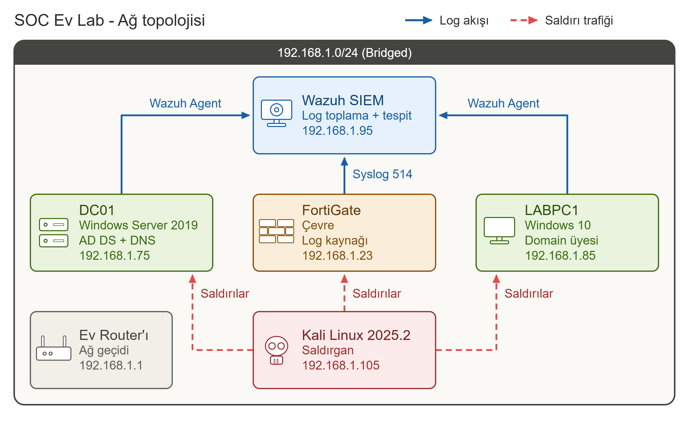

# SOC Ev Lab — Saldırı Simülasyonu & Detection Engineering

Active Directory, Wazuh SIEM ve FortiGate'ten oluşan bir ev laboratuvarında
**saldırı simülasyonu ve tespit (detection) çalışmaları**.

Bu depo bir öğrenme ve portföy projesidir: her aşamada bir saldırı yapılır,
saldırının loglarda bıraktığı iz bulunur ve o izi yakalayan tespit kuralı yazılır.
Amaç, SOC analisti bakış açısıyla **saldırı → log → tespit** döngüsünü uçtan uca kanıtlamaktır.

> ⚠️ Bu lab eğitim amaçlıdır. Tüm saldırılar yalnızca kendime ait, izole bir ev
> laboratuvarında, yetkili olduğum sistemlere karşı yapılmıştır.

## Bu projede neler yaptım? (özet)

- **4 saldırı zinciri** kurdum ve her birini SIEM üzerinden tespit ettim:
  Brute Force → Kerberoasting → Credential Dumping → Lateral Movement.
- **Çok sayıda özel Wazuh tespit kuralı** yazdım (brute-force, Kerberoasting, credential
  dumping, port tarama, **persistence**) ve her birini gerçek saldırı testiyle doğruladım.
- Tespitleri **MITRE ATT&CK** ile eşleyip bir **Navigator kapsam haritası** üretip
  **gap analizi** yaptım (bkz. Aşama 8).
- Gerçekçi bir **olay müdahale (IR) vaka raporu** hazırladım (bkz. Aşama 9).
- **FortiGate syslog** entegrasyonu ile çevre (perimeter) loglarını SIEM'e aldım ve
  port tarama tespiti yazdım (Aşama 10).
- "Hazır kural mı, özel kural mı?" muhakemesiyle **gereksiz kural yazmadan** boşlukları
  kapattım — olgun bir detection engineering yaklaşımı (bkz. Aşama 7).

## Detection Coverage (teknik → tespit)

| MITRE Tekniği | Taktik | Aşama | Tespit (rule.id) | Tip |
|---------------|--------|-------|------------------|-----|
| **T1046** Network Service Discovery | Reconnaissance | 10 | 100400 / 100401 | Özel kural |
| **T1547.001** Registry Run Keys | Persistence | 14 | 100500 / 100501 (lvl 12) | Özel kural (2 katmanlı) |
| **T1053.005** Scheduled Task | Persistence | 14 | 100510 / 100511 (lvl 12) | Özel kural (2 katmanlı) |
| **T1071** Application Layer Protocol (C2) | Command and Control | 15 | 100600 (lvl 10) / 100601 beaconing (lvl 13) | Özel kural (2 katmanlı) |
| **T1048** Exfiltration Over Alt. Protocol (DNS) | Exfiltration | 17 | 100700 / 100701 hacim (lvl 13) / 100702 (lvl 12) | Özel kural (3 katmanlı) |
| **T1110** Brute Force | Credential Access | 05 | 100100 (lvl 10) | Özel kural |
| **T1558.003** Kerberoasting | Credential Access | 06 | 100300 (lvl 12) | Özel kural |
| **T1003.001** LSASS Memory (Cred. Dumping) | Credential Access | 07 | 100310 + 100320 | Özel kural (imza+davranış) |
| **T1021.002** SMB / Admin Shares | Lateral Movement | 07 | 92650 (lvl 12) | Hazır ruleset |
| **T1569.002** Service Execution | Execution | 07 | 92307 / 7045 | Hazır ruleset |
| **T1550.002** Pass-the-Hash | Lateral Movement | 07 | 92652 (kısmi) | Hazır (kısmi) |
| **T1562.001** Impair Defenses | Defense Evasion | 07 | İzlenebilir (kuralsız) | Bilinen boşluk |

Tam kapsam haritası ve gap analizi için → [08 - MITRE ATT&CK](08-mitre-attack/).

## Mimari

## Ortam

| Rol | Sistem | Not |
|-----|--------|-----|
| Domain Controller | Windows Server 2019 | AD DS + DNS |
| İstemci | Windows 10 | Domain üyesi |
| SIEM | Wazuh | Log toplama + tespit |
| Saldırgan | Kali Linux 2025.2 | Saldırı araçları |
| Çevre | FortiGate | Log kaynağı (bkz. Aşama 10) |

**Ağ modu:** Bridged — tüm makineler ev ağından (`192.168.1.0/24`) IP alır.
Ayrıntılı IP planı ve bridge'in getirdiği uyarılar için
[00 - Temel ve Mimari](00-temel-ve-mimari/) bölümüne bak.

## İçindekiler

| # | Aşama | Konu |
|---|-------|------|
| 00 | [Temel ve Mimari](00-temel-ve-mimari/) | Topoloji, IP planı, bridge uyarıları |
| 01 | [Active Directory](01-active-directory/) | DC, domain, kullanıcı/servis hesapları |
| 02 | [Wazuh SIEM](02-wazuh-siem/) | SIEM kurulumu ve ajan kaydı |
| 03 | [Loglama ve Sysmon](03-loglama-sysmon/) | Sysmon + log görünürlüğü |
| 04 | [Keşif Tespiti](04-kesif-tespiti/) | Reconnaissance izleri |
| 05 | [Brute-force Tespiti](05-brute-force/) | T1110 — eşik tabanlı kural |
| 06 | [AD Saldırıları](06-ad-saldirilari/) | T1558.003 Kerberoasting |
| 07 | [Post-exploitation](07-post-exploitation/) | T1003.001 dumping + lateral movement |
| 08 | [MITRE ATT&CK](08-mitre-attack/) | Detection engineering + kapsam haritası |
| 09 | [Olay Müdahalesi](09-olay-mudahalesi/) | IR vaka raporu (IR-2026-001) |
| 10 | [FortiGate Entegrasyonu](10-fortigate/) | Syslog + T1046 port tarama tespiti |
| 11 | [Alarm Triyajı ve Playbook'lar](11-alarm-triyaji/) | Alert triage + TP/FP/BTP + 3 triyaj playbook'u |
| 12 | [Phishing / E-posta Analizi](12-phishing/) | Header + SPF/DKIM/DMARC + gerçek `.eml` analizi (GoPhish numunesi) |
| 13 | [Threat Intel & IOC Zenginleştirme](13-threat-intel/) | CDB bloklist (100800-100802) + Pyramid of Pain + `if_group` dersi |
| 14 | [Persistence (Kalıcılık)](14-persistence/) | T1547.001 Run key + T1053.005 scheduled task |
| 15 | [Command & Control (C2)](15-c2/) | T1071 — şüpheli süreç dışarı bağlantısı + beaconing |
| 17 | [Exfiltration / DNS Tunneling](17-exfiltration/) | T1048 — DNS tüneli: hacim + uzun subdomain |

> **Numaralandırma notu:** Klasör numaraları birer **konu etiketidir**, kesintisiz bir sıra
> değil. Öğrenme yolu saldırı kill-chain'ine göre ilerlediği için bazı numaralar (16, 18–21)
> **yol haritasında sırada bekliyor** ve eklendikçe dolacak.

## Durum

| Aşama | Durum |
|-------|-------|
| 00 — Temel ve Mimari | ✅ Tamamlandı |
| 01 — Active Directory | ✅ Tamamlandı |
| 02 — Wazuh SIEM | ✅ Tamamlandı |
| 03 — Loglama ve Sysmon | ✅ Tamamlandı |
| 04 — Keşif Tespiti | ✅ Tamamlandı |
| 05 — Brute-force Tespiti | ✅ Tamamlandı |
| 06 — AD Saldırıları (Kerberoasting) | ✅ Tamamlandı |
| 07 — Post-exploitation | ✅ Tamamlandı |
| 08 — MITRE ATT&CK | ✅ Tamamlandı |
| 09 — Olay Müdahalesi | ✅ Tamamlandı |
| 10 — FortiGate Entegrasyonu | ✅ Tamamlandı |
| 11 — Alarm Triyajı ve Playbook'lar | ✅ Tamamlandı |
| 12 — Phishing / E-posta Analizi | ✅ Tamamlandı |
| 13 — Threat Intel & IOC Zenginleştirme | ✅ Tamamlandı |
| 14 — Persistence (Kalıcılık) | ✅ Tamamlandı |
| 15 — Command & Control (C2) | ✅ Tamamlandı |
| 17 — Exfiltration / DNS Tunneling | ✅ Tamamlandı |

### Yol haritası (sıradaki)

- [ ] AS-REP Roasting (T1558.004) — Aşama 6 genişletmesi
- [ ] LLMNR/NBT-NS zehirleme (T1557.001) tespiti
- [ ] Özel kuralların **Sigma** formatına çevrilmesi (vendor-bağımsız)
- [x] Defender/sistem süreci LSASS FP tuning (100321 allowlist — Aşama 7) ✅

## Kullanılan beceriler

`Active Directory` · `Wazuh SIEM` · `Sysmon` · `Detection Engineering`
`MITRE ATT&CK` · `Log Analizi` · `Incident Response` · `FortiGate` · `Kali Linux`
`Kerberoasting` · `Credential Dumping` · `Lateral Movement` · `Alert Triage` · `Playbook`
`Persistence` · `Sysmon` · `Command & Control` · `Beaconing` · `Network Detection`
`Exfiltration` · `DNS Tunneling` · `Phishing Analizi` · `E-posta Header Analizi` · `SPF/DKIM/DMARC`
`Threat Intelligence` · `IOC / CDB Bloklist` · `Pyramid of Pain`

---
*Bu lab eğitim amaçlıdır. Tüm saldırılar yalnızca kendi izole/ev laboratuvarımda,
kendi sistemlerime karşı yapılmıştır.*
